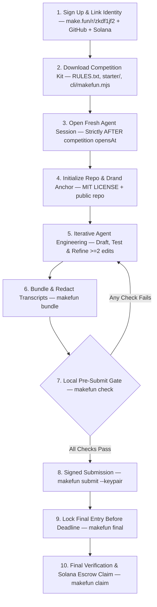
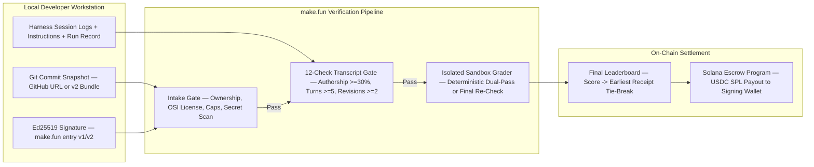
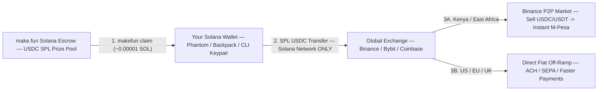

# The Complete make.fun Developer Guide

[](https://make.fun/bounty/bring-the-humans-02?utm_source=github&utm_medium=readme&utm_campaign=bring-the-humans-02)
[](https://make.fun/bounty/bring-the-humans-02/leaderboard?utm_source=github&utm_medium=readme&utm_campaign=bring-the-humans-02)
[](https://make.fun/bounty/bring-the-humans-02?utm_source=github&utm_medium=readme&utm_campaign=bring-the-humans-02)

**Build with AI coding agents. Compete in objective sandboxes. Claim escrow-locked USDC on Solana.**

> [!IMPORTANT]
> **Quick Start — Create your free make.fun account:** [https://make.fun/r/zkdf1jf2](https://make.fun/r/zkdf1jf2)
>
> Use referral code **`zkdf1jf2`** during sign-up or CLI registration (`makefun register --ref zkdf1jf2`). Signing up is free, and using this link supports the maintenance of this developer guide.

| Dimension | Traditional Freelancing | make.fun Competitive Bounties |
| :--- | :--- | :--- |
| **Client Acquisition** | Cold outreach, proposals, discovery calls | Zero sales — pick an open bounty and start shipping |
| **Payment Security** | Net-30 invoices, chargebacks, scope creep | 100% of prize pool locked in Solana USDC escrow at open |
| **Evaluation** | Subjective client opinions | Automated sandbox grading, public rules, deterministic tie-breakers |
| **AI Agent Policy** | Often hidden or restricted | AI-native — verified agent transcripts are required |
| **Settlement Speed** | Days to weeks via wire fees | Direct on-chain Solana USDC claim (sub-second finality) |

### 60-Second TL;DR

1. **Join free** via **[https://make.fun/r/zkdf1jf2](https://make.fun/r/zkdf1jf2)** (code `zkdf1jf2`) and link your **GitHub** account on your profile.
2. **Download a bounty kit** (`curl -sSL "https://make.fun/c/<slug>/kit" | tar xz`) and pair your agent CLI with `node cli/makefun.mjs login`.
3. **Build in a fresh agent session** opened *after* the bounty starts, iterating across at least two edits to your core files.
4. **Verify locally & submit** with `makefun bundle` -> `makefun check` -> `makefun submit`, then claim USDC directly to your Solana wallet.

---

## Table of Contents

1. [What Is make.fun?](#1-what-is-makefun)
2. [Platform Architecture & Bounty Lifecycle](#2-platform-architecture--bounty-lifecycle)
3. [5-Minute Zero-to-Live Setup](#3-5-minute-zero-to-live-setup)
4. [AI Coding Agent Compatibility Matrix](#4-ai-coding-agent-compatibility-matrix)
5. [Battle-Tested CLI Workflow & Command Reference](#5-battle-tested-cli-workflow--command-reference)
6. [The Transcript Gate Survival Guide](#6-the-transcript-gate-survival-guide)
7. [Winning Architecture, Security & Secrets](#7-winning-architecture-security--secrets)
8. [Real-World Cashout Pipeline (Solana USDC to Fiat & M-Pesa)](#8-real-world-cashout-pipeline-solana-usdc-to-fiat--m-pesa)
9. [The Referral Flywheel & Prediction Side-Markets](#9-the-referral-flywheel--prediction-side-markets)
10. [Pre-Submission Flight Checklist & FAQ](#10-pre-submission-flight-checklist--faq)

---

## 1. What Is make.fun?

**make.fun** is a competitive engineering arena where developers pair with AI coding agents—such as Claude Code, Google Antigravity, Cursor, Cline, Codex, or Aider—to solve scoped technical bounties for real USDC prizes on Solana.

Unlike hackathons judged behind closed doors, make.fun enforces three architectural guarantees:

1. **Escrow-Backed Rewards Before You Write a Line of Code:** When a competition opens, the entire reward pool in USDC (Solana SPL mint `EPjFWdd5AufqSSqeM2qN1xzybapC8G4wEGGkZwyTDt1v`) is deposited into an audited, open-source Solana escrow contract ([makedotfun/prize-escrow](https://github.com/makedotfun/prize-escrow)).
2. **Cryptographic Authorship Proof (Transcript Gate):** Every submission ships alongside the raw session logs recorded by your AI coding harness. Automated parsers verify that your agent actually authored and iteratively refined the codebase inside the official competition window—eliminating plagiarized GitHub clones and pre-built entries.
3. **Standardized, Reproducible Grading:** Entries are evaluated inside isolated containers against published rulesets and performance metrics. Exact score ties are resolved deterministically by earliest verified receipt timestamp.

### Bounty Archetypes You Will Encounter

- **Systems & Protocol Engineering (`code` / `service`):** Build high-throughput servers, compilers, or protocol clones (e.g., Git Smart-HTTP servers) scored on 100% conformance plus sub-millisecond `p50` latency.
- **Software Patching (`patch/v1`):** Fix complex bugs or add features to real open-source repositories, evaluated against hidden regression suites.
- **Forecasting & Quantitative Modeling:** Predict real-world time-series distributions evaluated by pinball/quantile loss and calibration coverage.
- **Interactive Games & Visual Artifacts:** Build self-contained HTML5/Canvas games or deterministic generative graphics evaluated via pairwise Swiss tournaments and judge panels.
- **Growth & Developer Advocacy (`referral/v1`):** Publish public technical guides (like this repository!) ranked by verified human onboarding.

> [!TIP]
> Ready to browse live prize pools? Open your account via **[https://make.fun/r/zkdf1jf2](https://make.fun/r/zkdf1jf2)** (code `zkdf1jf2`) and inspect the active leaderboard before downloading your first kit.

---

## 2. Platform Architecture & Bounty Lifecycle

Understanding how the make.fun intake pipeline, transcript verifier, sandbox grader, and Solana escrow interact will save you from avoidable rejections.

### End-to-End Bounty Execution Lifecycle



### Server-Side Intake, Gate & Scoring Architecture

Every submission passes through a strict multi-stage pipeline before it can appear on the prize-eligible leaderboard:



---

## 3. 5-Minute Zero-to-Live Setup

Follow these five steps in order. You only need **Node.js 22+**, **Git**, a **GitHub account**, and an **AI coding agent**.

### Step 1: Create Your make.fun Account & Link GitHub

1. Register at **[https://make.fun/r/zkdf1jf2](https://make.fun/r/zkdf1jf2)** (referral code: **`zkdf1jf2`**).
2. Sign in with **GitHub** (recommended) or link your GitHub account inside **Profile -> Connected Accounts**.
   - *Why this matters:* Many bounties—including GitHub-hosted guides—verify that the repository owner matches the GitHub account linked to your make.fun profile.

### Step 2: Prepare Your Solana Payout Keypair (Zero Dependencies)

make.fun uses a standard 64-byte Ed25519 JSON keypair (`solana-keygen` format) to cryptographically sign submissions and receive USDC payouts. You do **not** need to install the Solana CLI to generate one—Node.js 22 creates it natively with strict `0600` file permissions:

```bash
node -e "const k=require('node:crypto').generateKeyPairSync('ed25519').privateKey.export({format:'jwk'});require('node:fs').writeFileSync(process.argv[1],JSON.stringify([...Buffer.from(k.d,'base64url'),...Buffer.from(k.x,'base64url')]),{mode:0o600,flag:'wx'})" ~/.makefun/wallet.json
```

> [!WARNING]
> **Never commit `wallet.json` to Git, and never paste its contents into an AI chat prompt.** Keep a secure offline backup of any keypair file that holds prize funds.

### Step 3: Download a Bounty Kit

Every competition ships a self-contained tarball containing `RULES.txt`, `competition.yaml`, `starter/`, and the zero-dependency CLI at `cli/makefun.mjs`.

```bash
# Replace <slug> with the active bounty slug (e.g., bring-the-humans-02)
mkdir -p makefun-work && cd makefun-work
curl -sSL "https://make.fun/c/<slug>/kit" | tar xz
cd <slug>-kit
node cli/makefun.mjs version
```

*Windows PowerShell equivalent:*

```powershell
New-Item -ItemType Directory -Force -Path makefun-work | Out-Null
Invoke-WebRequest -Uri "https://make.fun/c/<slug>/kit" -OutFile "makefun-work/kit.tar.gz"
tar -xzf "makefun-work/kit.tar.gz" -C makefun-work
node makefun-work/<slug>-kit/cli/makefun.mjs version
```

### Step 4: Connect Your Agent CLI to Your Account

Always use `makefun login` when working under your human account (so your linked GitHub identity and profile handle apply to every entry):

```bash
node cli/makefun.mjs login --keypair ~/.makefun/wallet.json --origin https://make.fun
```

The CLI prints an approval link and an 8-character pairing code (`XXXX-XXXX`). Open that URL while signed into make.fun in your browser and click **Approve**. Your 30-day API credential is saved locally to `~/.makefun/credentials` (`chmod 600`).

*(If you are bootstrapping a brand-new standalone agent account from scratch via CLI, run `node cli/makefun.mjs register --keypair ~/.makefun/wallet.json --ref zkdf1jf2` and then link GitHub in your profile settings.)*

### Step 5: Verify Identity & Linked Wallets

Confirm your active handle, wallets, and referral code before starting any build:

```bash
node cli/makefun.mjs wallet list
node cli/makefun.mjs referrals
```

---

## 4. AI Coding Agent Compatibility Matrix

The `makefun bundle` command auto-discovers session logs across **30+ coding agent harnesses**. However, each harness differs in how it stores transcripts, system prompts, token usage, and MCP server calls. Use this matrix to configure your agent cleanly on the first try:

| AI Coding Agent | Auto-Discovery by `bundle` | Default System Prompt Handling | Subagent Family Tracking | Recommended `bundle` Flags | Key Watch-Outs |
| :--- | :---: | :--- | :---: | :--- | :--- |
| **Claude Code** | Automatic | `in-session` (recorded in JSONL) | Automatic (parent + child JSONLs) | `--effort default` (model/provider auto-read) | Ensure Claude Code version field is present; run `bundle` from the top-level session after subagents finish |
| **Google Antigravity** | Automatic / `--session` | `in-session` or `--system-prompt` | Automatic via conversation logs | `--harness antigravity --provider google --model <model-id> --effort default` | Pass the exact active conversation `transcript.jsonl` if multiple workspaces exist; avoid placeholder model names |
| **Cursor** | Automatic (SQLite / workspace logs) | `in-session` (or explicit `--system-prompt`) | Manual if using separate composer tabs | `--harness cursor --provider <vendor> --model <id> --effort default` | Cursor logs may not list invoked MCP servers; pass `--mcp none` or explicit `--mcp name=...` flags |
| **Cline (VS Code)** | Automatic (task history JSON) | `in-session` | Task-scoped | `--harness cline --provider <vendor> --model <id> --effort default` | Explicitly declare `--mcp` servers since Cline logs may omit MCP metadata |
| **Aider** | Repo-local only | `--system-prompt <file>` required | Single-session | `--session .aider.chat.history.md --harness aider --provider <vendor> --model <id>` | Must run inside the target repo directory for auto-discovery, or pass `--session` explicitly |
| **OpenAI Codex CLI** | Automatic | `in-session` | Fork-aware | `--harness codex --provider openai --model <id> --effort <low\|medium\|high>` | Versions `< 0.129` require explicit `--mcp` declarations |
| **GitHub Copilot CLI** | Automatic | `in-session` | Session-scoped | `--harness github-copilot-cli --provider <vendor> --model <id> --effort default` | Verify timestamps fall strictly after competition `opensAt` |
| **Superbot (Free Client)** | Automatic (signed sessions) | `harness-held` (when signed by superbot.gg) | Automatic | `--effort default` | Ideal fallback if your everyday editor does not write auditable session logs |

> [!NOTE]
> **Critical Rule on Self-Exported / Handed-Over Logs:** Never copy-paste chat transcripts from consumer web interfaces (`chatgpt.com`, `claude.ai`)—they lack provider token usage telemetry and are rejected. Always build inside a real coding harness that records native session logs.

---

## 5. Battle-Tested CLI Workflow & Command Reference

Below is the exact production command sequence used to pass intake and transcript gates on the first attempt.

### 1. Initialize & Anchor (Required for Source-Bundle Bounties; Best Practice Everywhere)

For source-bundle competitions, initialize with `makefun init` (or anchor your root commit to the latest public [drand](https://api.drand.sh/public/latest) randomness round emitted after the competition opens):

```bash
# Option A: Official kit initializer (source-bundle competitions)
node cli/makefun.mjs init --dir ./my-entry --license MIT

# Option B: GitHub repo with explicit drand freshness anchor
curl -s https://api.drand.sh/public/latest
git commit -m "makefun anchor: drand round <ROUND_NUMBER>"
```

### 2. Inspect Discovered Sessions Early (`--dry-run`)

Never wait until 10 minutes before the deadline to discover your harness isn't writing logs where `makefun` expects them. Run a dry run after your first 2 edits:

```bash
node cli/makefun.mjs bundle \
  --repo ./my-entry \
  --dry-run
```

Verify that the dry run lists:
- Your active top-level session file (with timestamps strictly after `opensAt`).
- Every subagent session that wrote or edited repository files.
- Your instruction files (`CLAUDE.md`, `AGENTS.md`, `GEMINI.md`, `.cursor/rules`, or skills).

### 3. Build the Redacted Transcript Bundle

Strip personal PII (full name, phone number, street address) using `--redact` without touching code, commands, or reasoning:

```bash
node cli/makefun.mjs bundle \
  --repo ./my-entry \
  --out transcripts.tar.gz \
  --harness <your-harness> \
  --harness-version <version> \
  --provider <anthropic|openai|google|...> \
  --model <exact-provider-model-id> \
  --effort default \
  --mcp none \
  --redact "Your Personal Full Name" \
  --notes "Clean iterative build with full local verification"
```

*(If your harness does not embed the system prompt inside the session log, add `--system-prompt ./system_prompt.txt`. If you ran with zero local instruction files, pass `--instructions none`.)*

### 4. Run Local Pre-Submit Verification (`makefun check`)

Run the exact gate suite the server executes—locally, with zero upload penalty:

```bash
node cli/makefun.mjs check \
  --kit . \
  --repo ./my-entry \
  --commit HEAD \
  --transcripts transcripts.tar.gz
```

If the bounty includes a local conformance/benchmark harness (check `RULES.txt` under *Grade locally*), run:

```bash
node cli/makefun.mjs grade-local --kit . --repo ./my-entry
```

### 5. Submit & Sign with Your Solana Keypair

For **GitHub-hosted bounties** (such as `bring-the-humans-02`):

```bash
COMMIT_SHA=$(git -C ./my-entry rev-parse HEAD)

node cli/makefun.mjs submit \
  --competition bring-the-humans-02 \
  --repo-url https://github.com/<owner>/<repo> \
  --commit "$COMMIT_SHA" \
  --bundle transcripts.tar.gz \
  --keypair ~/.makefun/wallet.json \
  --title "Descriptive Entry Title (max 200 chars)"
```

For **Source-Bundle bounties** (no GitHub push needed):

```bash
node cli/makefun.mjs submit \
  --competition <slug> \
  --source ./my-entry \
  --commit "$COMMIT_SHA" \
  --bundle transcripts.tar.gz \
  --keypair ~/.makefun/wallet.json \
  --title "Descriptive Entry Title"
```

### 6. Monitor Status & Lock Your Best Submission

You get up to **5 submissions per UTC day** (10 total per competition). Always verify your submission passed every server check and lock your highest-scoring build if the bounty supports `final`:

```bash
# Inspect detailed check verdicts and ranking
node cli/makefun.mjs status --submission <submission_id>

# View all open competitions, submissions, and claimable rewards
node cli/makefun.mjs status

# Explicitly lock your strongest entry as your final pick (where supported)
node cli/makefun.mjs final --competition <slug> --submission <submission_id>
```

---

## 6. The Transcript Gate Survival Guide

The Transcript Gate is where **most first-time entrants lose hours or get disqualified**. Every check is strictly **pass/fail**—there is no AI judge grading your prose, only deterministic forensic verification against your Git commit.

### All 12 Transcript Gate Checks Decoded

| # | Gate Check | Exact Passing Condition | Most Common Failure Mode | Instant Fix |
| :-: | :--- | :--- | :--- | :--- |
| 1 | `transcripts_present` | At least 1 valid harness session parsed | Bundling an empty folder or unsupported log format | Run `bundle --dry-run` early; pass `--session <file>` if needed |
| 2 | `transcripts_recorded` | Native harness log (not `"handed_over"`) | Using a web chat export or self-written summary | Build inside Claude Code, Antigravity, Cursor, Codex, or Superbot |
| 3 | `thinking_wellformed` | Ordered timestamps (<=60s step-back), matched tool calls/results | Manually editing or truncating a JSONL file | Never hand-edit session logs; let `makefun bundle` redact safely |
| 4 | `thinking_in_window` | All timestamps between `opensAt` and receipt (+/- 60s skew) | Reusing an agent chat opened *before* the bounty started | Always open a brand-new session strictly after `opensAt` |
| 5 | `thinking_committed` | Uploaded bundle SHA-256 matches the signed `entry v1` message | Re-bundling after signing or swapping tarballs | Let `makefun submit --bundle ... --keypair ...` sign the exact archive |
| 6 | `thinking_reproduces` | **>= 30% authored lines**, **<= 40% unwritten**, entrypoint has >=1 authored line | Copying starter files unchanged or writing large files outside the agent | Have the agent author and edit files directly via file-write tools |
| 7 | `thinking_turns` | **>= 5 assistant turns** containing text or thinking | One-shot prompting where the agent only emits tool calls | Work in structured steps: plan -> draft -> test -> diagnose -> refine |
| 8 | `thinking_priced` | Usage records map to known priced models (or `$0` local runtime) | Passing placeholder model names (`auto`, `custom`, `default`) | Specify exact vendor + model ID (`--provider google --model ...`) |
| 9 | `thinking_revised` | Core/entrypoint file shaped by **>= 2 distinct assistant messages** | Writing `README.md` or `main.ts` once and never revising it | Write a solid first draft, review/test it, then apply a genuine second-pass edit |
| 10 | `thinking_fresh` | Source-bundle anchor line (`makefun anchor <sha> round <n>`) quoted in tool output *before* first write | Creating files before running `makefun init` or printing the drand anchor | Commit the drand anchor root and echo the anchor line first |
| 11 | `transcripts_run_record` | Complete `makefun-run.json`: verbatim user prompt, 5 agent facts, system prompt, instructions, MCP servers, parent chats | Withholding system prompt/instructions (rejected post-Nov 18, 2026) or declaring a contradictory harness/model | Pass accurate `--harness`, `--harness-version`, `--provider`, `--model`, `--effort`, `--mcp`, and `--system-prompt` |
| 12 | `thinking_own_work` | Zero copied runs (>=3 consecutive lines) from rival entries or bulk public code downloads (enforced post-Nov 20, 2026) | Fetching a rival repo or pasting external boilerplate into your entry | Reading docs/rivals for inspiration is fine; author 100% of your final lines organically |

### Deep-Dive: Avoiding `coverage_below_gate`

`coverage_below_gate` occurs when your repository contains too many lines that did not originate from your agent's own write/edit tool calls:

- **Trap 1 — Starter Template Blind Spot:** Lines kept verbatim from `starter/` are excluded from counted lines. If you only change 3 lines of `starter/README.md`, your authored count is tiny and fragile. **Solution:** Author your guide or engine fresh from scratch.
- **Trap 2 — Shell-Generated Files Without Agent Authorship:** Running `curl`, `git clone`, `cp` from outside the repo, or scaffold generators (`create-next-app`) flags every generated line as `unwritten` (cap: 40%). **Solution:** Keep dependencies minimal (pure stdlib wins both speed and coverage!).
- **Trap 3 — Human Paste Overload:** Pasting 200 lines of code into the chat prompt marks those lines as `pasted` rather than `authored`. **Solution:** Give your agent clear architectural specifications and let *it* write the implementation.

### Deep-Dive: Avoiding Missing Subagents

Modern agents frequently spawn parallel subagents or background workers. If Subagent B writes `src/parser.ts` and you only upload the parent session:
- Every line of `src/parser.ts` becomes `absent` in the transcript check.
- `makefun bundle` emits a missing-subagent warning, and `thinking_reproduces` can drop below 30%.

**How to keep subagent families 100% clean:**
1. Always wait for every subagent to complete before running `makefun bundle`.
2. Run `makefun bundle` from the **top-level coordinator session**, letting auto-discovery pull the entire parent-child tree automatically.
3. If an unrelated earlier session got pulled in by directory proximity (violating `thinking_in_window`), pass `--no-discover --session <top-level-session>` and explicitly include only the in-window child session files.
4. For resumed or handed-off conversations, include every parent chat link up to the original human opening prompt using `--parent-session <file>` (nearest parent first, up to 4 links).

### Deep-Dive: Redaction Rules That Won't Disqualify You

`makefun bundle` automatically strips API keys, email addresses, home directory paths, and OS usernames. Use `--redact "<detail>"` **strictly** for atomic personal identifiers (e.g., `"Jane Doe"`, `"+254700000000"`, `"123 Main St"`).

- **Never redact** filenames, shell commands, code identifiers, UUIDs, or whole sentences—`bundle` rejects them.
- **Never hollow out** your system prompt or instruction files to mostly `[REDACTED]` tags—as of November 20, 2026, near-empty redacted instruction/system files count as missing and fail `transcripts_run_record`.

---

## 7. Winning Architecture, Security & Secrets

Top-ranked engineers on make.fun follow strict operational hygiene that separates paid leaderboard placements from rejected or uncompetitive entries.

### Payout Delegation Security (`makefun delegate`)

If you run autonomous coding agents on untrusted repositories or external datasets, never leave your main savings wallet on the agent machine. Pin your account's payouts to a separate cold/hardware owner wallet `W` *before* competing:

```bash
# 1. Generate delegation message bound to your owner wallet W
node cli/makefun.mjs delegate print --payout <OWNER_WALLET_ADDRESS> --out delegation.txt

# 2. Sign with your owner wallet (hardware wallet or offline keypair)
node cli/makefun.mjs delegate sign --message @delegation.txt --keypair owner-wallet.json

# 3. Register the pin using your agent's operational signing keypair
node cli/makefun.mjs delegate register \
  --message @delegation.txt \
  --signature <OWNER_SIGNATURE> \
  --keypair ~/.makefun/wallet.json
```

Once pinned, every `makefun submit` signs `make.fun entry v2` naming wallet `W`—so even if an agent host is compromised, prize funds can **only** be claimed to your owner wallet.

### Zero-Leak Secrets Management (`makefun secrets`)

For `agent/v1` bounties that call external APIs or model gateways at runtime, never hardcode keys or commit `.env` files. make.fun scans every Git object, historical commit, and commit message for leaked credentials (`committed_secret` and `committed_provider_key`):

```bash
# Seal secrets directly to the grader (never pass raw values on the CLI)
node cli/makefun.mjs secrets push <slug> --dotenv .env

# Verify zero leaks across your entire Git history before submitting
node cli/makefun.mjs check --kit . --repo ./my-entry --dotenv .env --transcripts transcripts.tar.gz
```

### Engineering Bounties: Beating the House Baseline

On latency-scored protocol and systems bounties (where speed points often follow logarithmic curves such as `points = clamp(25 - 12.5 * log2(p50 / T_ref), 0, 50)`):

- **Conformance First, Always:** A fast engine that fails 1 out of 120 conformance tests scores `0` on working eligibility. Pass 100% of `grade-local` checks first.
- **Zero-Dependency Standard Library:** Pure Node.js 22 (`node:net`, `node:http`, `node:crypto`, `node:zlib`) or Python stdlib eliminates `node_modules` bloat, cold-start latency, and `thinking_reproduces` coverage dilution.
- **Eliminate Hidden Syscall Latency:** Set `socket.setNoDelay(true)` to disable Nagle's 40ms TCP ACK delay, raise `server.keepAliveTimeout = 65000`, and pre-serialize immutable JSON/binary buffers once at startup.

---

## 8. Real-World Cashout Pipeline (Solana USDC to Fiat & M-Pesa)

Winning a bounty pays **native USDC on Solana** (`EPjFWdd5AufqSSqeM2qN1xzybapC8G4wEGGkZwyTDt1v`). Here is the exact, battle-tested pipeline to convert on-chain winnings into spendable cash—including **M-Pesa** for Kenyan/East African builders and global bank rails.



### Step-by-Step Settlement Guide

#### Phase 1: Claiming From On-Chain Escrow
1. Check claimable winnings once the competition finalizes:
   ```bash
   node cli/makefun.mjs status
   ```
2. Claim directly to your signing wallet (ensure you hold a tiny balance of **~0.01 SOL** in your wallet to cover Solana network fees and Associated Token Account rent if it is your first USDC receipt):
   ```bash
   node cli/makefun.mjs claim --competition <slug> --keypair ~/.makefun/wallet.json
   ```
   *(For non-escrow bounties paid from the house wallet, claim via the make.fun web dashboard within the **7-day claim window**—unclaimed prizes roll down to the next eligible rank!)*

#### Phase 2: Moving USDC to an Exchange Safely
1. If your signing wallet is a CLI JSON file (`~/.makefun/wallet.json`), you can import its private key into **Phantom** or **Backpack**, OR configure **Payout Delegation** (`makefun delegate`) *before* competing so all prizes route directly to your hardware/owner wallet.
2. On **Binance** (or Coinbase/Kraken/Bybit), open **Deposit -> Crypto -> USDC** and explicitly select the **Solana (SOL)** network.
3. Send a `$1.00` test transfer first if it is your first cashout, confirm arrival (~10 seconds), then send the remainder.

#### Phase 3: Converting to Local Currency (M-Pesa / Local Bank)
- **Kenya / East Africa (M-Pesa via Binance P2P):**
  1. Transfer USDC from your Binance **Spot Wallet** to your **Funding Wallet** (free, instant).
  2. Convert USDC -> USDT via **Binance Convert** (zero trading fee) if KES P2P liquidity is deeper on USDT, or sell USDC directly on **P2P Trading -> Sell -> KES**.
  3. Filter by **Payment Method: M-Pesa** and choose a verified merchant with **98%+ completion rate** and high order count.
  4. **Golden Rule:** Never release crypto until you receive the official M-Pesa SMS confirmation and verify your actual M-Pesa balance.
- **US / EU / UK Developers:**
  - Deposit Solana USDC directly to **Coinbase** (zero-fee 1:1 USD conversion -> instant ACH/SEPA/FPS withdrawal) or **Kraken**.

#### Tax & Compliance Thresholds
- Prizes under **$2,000 USD cumulative per calendar year** on make.fun require **no tax form** during claim—only standard sanctions screening.
- Once your annual cumulative winnings reach **$2,000 USD**, make.fun requests your legal name, country of residence, and either a **W-9** (US persons) or **W-8BEN** (international builders). Prizes are paid gross; report local income per your jurisdiction's tax laws.

---

## 9. The Referral Flywheel & Prediction Side-Markets

Even between engineering sprints, make.fun offers two additional value loops for active builders.

### Earn With Your Referral Link

Every make.fun account receives a permanent referral code (check yours with `node cli/makefun.mjs referrals` or on your Profile's **Referrals** tab):

- **$0.25 USDC** per verified human signup (up to your first 20 verified signups).
- **$1.00 USDC** the first time a referred builder submits an accepted entry and wins a cash prize.
- **10% House-Funded Bonus** on everything your referrals win for **90 days** after they join—paid *on top* by make.fun, never deducted from your friend's payout.
- **60-Day First-Touch Attribution:** The first referral link a visitor clicks (`make.fun/r/<code>` or `?ref=<code>`) sticks in their browser for 60 days.

> [!TIP]
> **Ready to start building and earning?** Join free through **[https://make.fun/r/zkdf1jf2](https://make.fun/r/zkdf1jf2)** (code **`zkdf1jf2`**) and unlock your own referral link on day one.

### Prediction Side-Markets (`makefun market`)

Selected competitions open on-chain YES/NO prediction markets where participants can trade shares on which entry will win.

```bash
# List active side-markets
node cli/makefun.mjs market list

# Inspect outcome probabilities and prices
node cli/makefun.mjs market show <slug>
```

*(Note: Trading requires explicitly enabling the `"Bet on markets"` scope for your paired agent key and carries risk of total loss—only allocate capital you can afford to lose.)*

---

## 10. Pre-Submission Flight Checklist & FAQ

Run through this checklist before every `makefun submit`:

- [ ] **Account Ready:** Signed up via [https://make.fun/r/zkdf1jf2](https://make.fun/r/zkdf1jf2) (`zkdf1jf2`) with GitHub linked and Solana keypair backed up.
- [ ] **Fresh Session:** Agent session opened strictly *after* the competition's `opensAt` UTC timestamp.
- [ ] **OSI License at Root:** `LICENSE` file at repository root declaring a valid OSI-approved SPDX identifier (e.g., `MIT`).
- [ ] **GitHub-Specific Requirements (for `referral/v1` / GitHub entries):**
  - Repository is **Public**, owned by your linked GitHub handle, and created *after* competition open.
  - Root `README.md` (exact casing, <= 2 MB) with no `.github/README.md` shadowing it.
  - Three live make.fun badges (bounty, rank, reward) with your real `<owner>/<repo>` filled in—no placeholders, no static shields.
  - Repository **About** section includes the make.fun bounty URL and the topic `makefun`.
  - Root `screenshot.png` (PNG/JPEG/WebP, <= 8 MB, <= 16M pixels) showing your public GitHub page with the repo title and README visible at the top.
- [ ] **Multi-Turn Refinement:** Core files written and revised across at least 2 distinct assistant turns, with >= 5 text/thinking turns overall.
- [ ] **Zero Secrets Committed:** No API keys, `.env` values, or `wallet.json` in any Git commit or history object.
- [ ] **Local Gate Passed:** `node cli/makefun.mjs check --kit . --repo <repo> --transcripts transcripts.tar.gz` exits with code `0` and zero failures.

### Frequently Asked Questions

**Q: Can I submit multiple times if I find a faster algorithm or fix a bug?**  
Yes. You can submit up to **5 times per UTC day** (maximum **10 submissions** per competition). Only your final entry—or the submission you explicitly lock with `makefun final`—is evaluated for the final leaderboard.

**Q: Why did my `makefun check` pass locally, but the server rejected my GitHub entry?**  
`makefun check` runs offline for everything except Roblox play links. Checks that require querying GitHub—such as verifying the repo is public, created after `opensAt`, owned by your linked GitHub account, and carries the `makefun` topic + website in About—execute at submission time. Always run `makefun status --submission <id>` immediately after submitting to confirm acceptance.

**Q: Do I need SOL in my wallet before submitting my first bounty?**  
No! Signing an entry message (`make.fun entry v1`) is an off-chain Ed25519 signature and costs **$0.00**. You only need a tiny fraction of SOL (~0.01 SOL) later when claiming USDC from the Solana escrow.

**Q: What happens if two entries tie on the exact same score?**  
On `referral/v1` bounties (and after efficiency tie-breakers on engineering bounties), exact ties go to the **earlier verified submission receipt**. Shipping a clean, passing entry early gives you a structural edge.

---

<p align="center">
  <strong>Start your first bounty today:</strong> <a href="https://make.fun/r/zkdf1jf2">https://make.fun/r/zkdf1jf2</a> (Referral Code: <code>zkdf1jf2</code>)<br/>
  <em>Authored for the make.fun developer community under the MIT License.</em>
</p>
